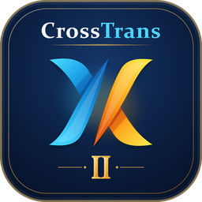
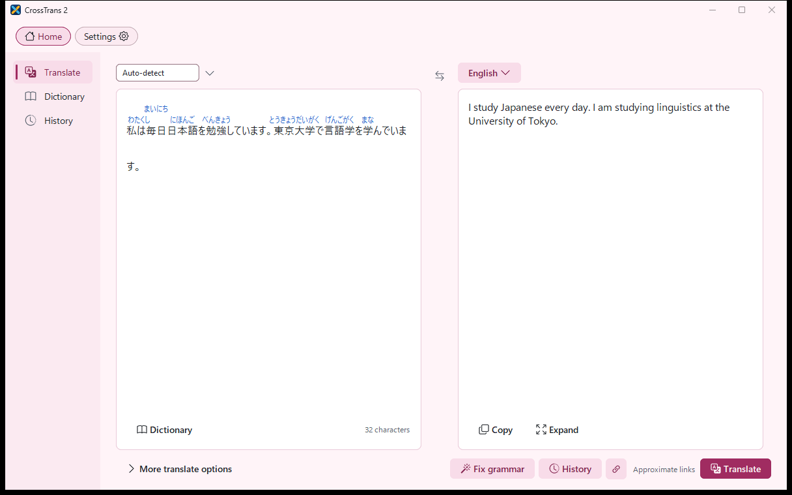
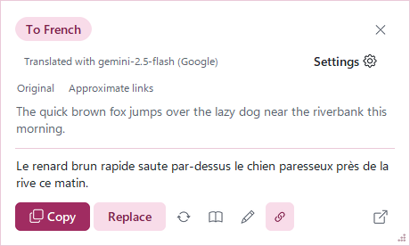
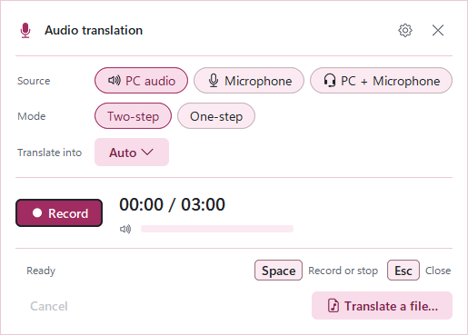
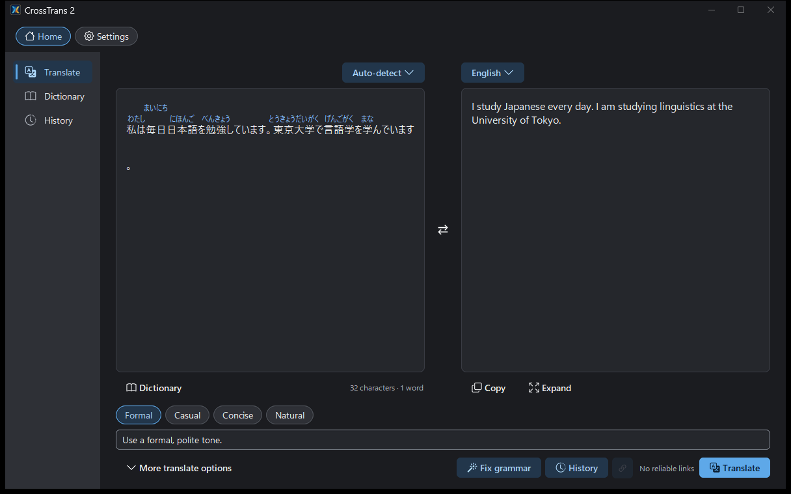
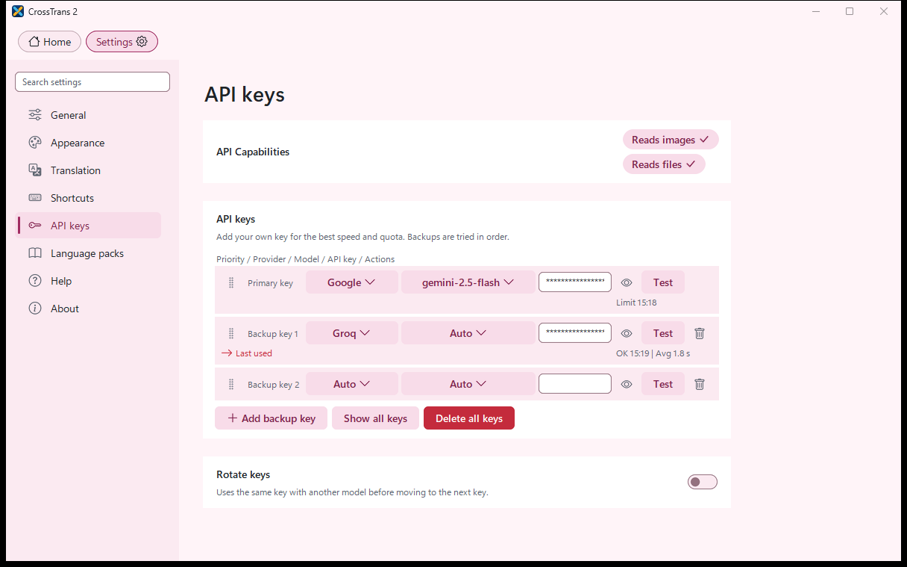
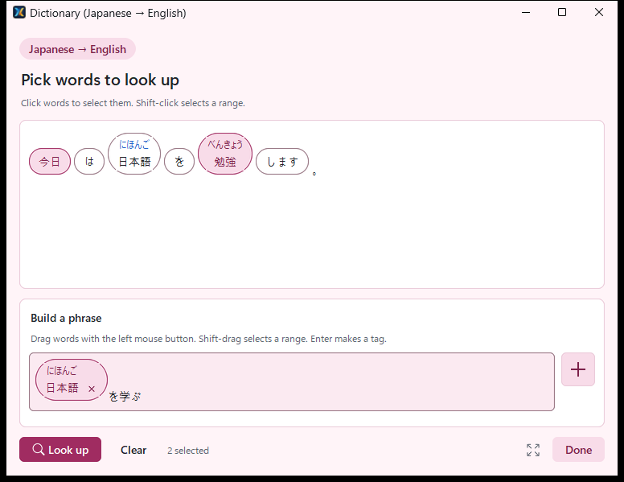
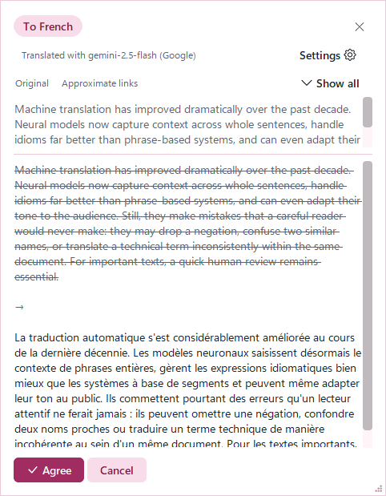

<p align="center">
  
</p>

<h1 align="center">CrossTrans 2</h1>

<p align="center">
  <strong>Fast, privacy-first AI translator for Windows — instant popups, screenshot OCR, live audio &amp; video translation, Japanese Furigana, interactive dictionary, and document translation.</strong>
</p>

<p align="center">
  <a href="https://github.com/Masaru-urasaM/CrossTrans2/releases/latest"></a>
  <a href="LICENSE"></a>
  
</p>

<p align="center">
  <a href="docs/USER_GUIDE.md"><strong>Full User Guide (English)</strong></a> &nbsp;·&nbsp;
  <a href="docs/USER_GUIDE_VI.md"><strong>Hướng dẫn sử dụng (Tiếng Việt)</strong></a> &nbsp;·&nbsp;
  <a href="CHANGELOG.md">Changelog</a> &nbsp;·&nbsp;
  <a href="SECURITY.md">Security</a>
</p>

---

<p align="center">
  
</p>

## Why CrossTrans 2?

CrossTrans 2 lives quietly in your Windows system tray and translates anything on your screen in one shortcut — using **your own API key** directly from your PC (no subscription lock-in, no middleman server storing your text).

- **Instant Quick Translate Anywhere** — Select text in browsers, PDFs, Word, Excel, chat apps, or code editors and press a hotkey (`Win + Alt + V/E/J/C`) for a clean popup right beside your cursor, with one-click **Copy** and **Replace** (with diff preview).
- **Screenshot OCR & Translate (`Win + Alt + S`)** — Drag over any region across multi-monitor setups (images, games, locked PDFs, slides) to extract and translate instantly.
- **Audio & Video Translation (`Win + Alt + A`)** — Record **PC audio**, **Microphone**, or **both** (up to 3 minutes) or upload audio/video files up to 30 minutes with two-step verbatim transcription or one-step direct translation.
- **Document & Image Translation** — Drag and drop `.txt`, `.md`, `.docx`, `.pdf` (including scanned PDFs), `.srt` subtitles (timings preserved), and images directly into the Translator.
- **Japanese & Language-Learning Aids** — Automatic **Furigana** readings above kanji, **Linked Reading** sentence-by-sentence hover alignment, an **Interactive Word-Picker Dictionary**, and installable offline word-segmentation **Language Packs**.
- **14 AI Providers & Smart Failover** — Works with **Google Gemini**, **OpenAI**, **Anthropic Claude**, **Groq**, **DeepSeek**, **OpenRouter**, **xAI**, **Mistral**, **Perplexity**, **Cerebras**, **SambaNova**, **Together**, **SiliconFlow**, and **HuggingFace** — add free-tier or paid backup keys that rotate automatically if a key hits a rate limit.
- **Local-First Security & Privacy** — API keys are encrypted per-user with Windows DPAPI and protected by **Windows Hello** when viewing; translation history stays local; diagnostics automatically exclude keys and user text.

<p align="center">
  
  &nbsp;&nbsp;
  
</p>

---

## Quick Start (2 Minutes)

1. **Download & Install**
   - Go to [GitHub Releases](https://github.com/Masaru-urasaM/CrossTrans2/releases/latest) and download **`CrossTrans2Setup_v2.0.1.exe`**.
   - Run the installer and follow the prompts. *(If Windows SmartScreen shows a "Windows protected your PC" prompt because the open-source binary is unsigned, click **More info** → **Run anyway** — see the [User Guide](docs/USER_GUIDE.md#installation--windows-smartscreen) for details and SHA-256 verification.)*
2. **Add a Free or Paid API Key**
   - Launch CrossTrans 2 and open **Settings → API keys** (or paste your key during the Welcome setup wizard).
   - **Recommended free-tier starting options:** [Google AI Studio (Gemini)](https://aistudio.google.com/apikey) for text + screenshots + PDFs + audio, or [Groq](https://console.groq.com/keys) for ultra-fast text & Whisper speech recognition.
   - Paste your key and click **Test** — leave Provider and Model on **Auto** to let CrossTrans detect and pick a working model automatically.
3. **Start Translating!**
   - Highlight text in any app and press `Win + Alt + V` (Vietnamese), `Win + Alt + E` (English), `Win + Alt + J` (Japanese), or `Win + Alt + C` (Chinese).

> **Need step-by-step screenshots, API key setup instructions, or troubleshooting?**
> Read the **[Full User Guide (English)](docs/USER_GUIDE.md)** or **[Hướng dẫn sử dụng (Tiếng Việt)](docs/USER_GUIDE_VI.md)**.

---

## Default Keyboard Shortcuts

All shortcuts can be customized or disabled in **Settings → Shortcuts**, and you can add up to 4 additional language shortcuts.

| Shortcut | Action |
| --- | --- |
| `Win + Alt + V` | Quick Translate selected text → **Vietnamese** |
| `Win + Alt + E` | Quick Translate selected text → **English** |
| `Win + Alt + J` | Quick Translate selected text → **Japanese** |
| `Win + Alt + C` | Quick Translate selected text → **Chinese (Simplified)** |
| `Win + Alt + S` | **Screenshot OCR** — drag over any screen area to translate |
| `Win + Alt + A` | **Audio Translation Panel** — record PC audio / mic or open a media file |
| `Win + Alt + G` | **Fix Grammar** *(disabled by default to avoid Xbox Game Bar conflict; enable in Shortcuts)* |
| `Esc` | Close active popup, cancel screenshot overlay, or close audio panel |

---

## Visual Preview

<table>
  <tr>
    <td align="center" width="50%">
      <br />
      <sub><b>Dark Mode &amp; Custom Tone Instructions</b> (Formal, Casual, Concise, Natural)</sub>
    </td>
    <td align="center" width="50%">
      <br />
      <sub><b>Multi-Provider API Keys</b> with drag-to-reorder priority &amp; automatic failover</sub>
    </td>
  </tr>
  <tr>
    <td align="center" width="50%">
      <br />
      <sub><b>Interactive Word-Picker Dictionary</b> with Furigana &amp; phrase builder</sub>
    </td>
    <td align="center" width="50%">
      <br />
      <sub><b>Safe In-Place Replace</b> with before/after preview (or instant paste)</sub>
    </td>
  </tr>
</table>

---

## Running from Source (Developers)

Requirements: **Windows 10/11 (64-bit)** and **Python 3.14** (recommended; matches CI).

```powershell
git clone https://github.com/Masaru-urasaM/CrossTrans2.git
cd CrossTrans2
python -m venv .venv
.\.venv\Scripts\Activate.ps1
pip install -r requirements.txt -c constraints.txt
python main.py
```

### Running Tests & Linting

```powershell
pip install -r requirements-dev.txt -c constraints.txt
python -m ruff check src tools tests main.py config.py
python -m pytest tests/ -q
```

### Building the Windows Executable & Installer

```powershell
python -m PyInstaller --clean --noconfirm --distpath dist-release --workpath build-release CrossTrans.spec
python tools/verify_furigana_bundle.py --exe dist-release/CrossTrans2.exe
python tools/verify_ui_bundle.py --exe dist-release/CrossTrans2.exe
./tools/build_installer.ps1 -SourceExe dist-release/CrossTrans2.exe
```

---

## Privacy, Security & License

- **Bring Your Own Key (BYOK):** Your requests go directly from your machine to the AI provider(s) you configure. CrossTrans 2 never collects or stores your translations.
- **Security Policy:** See [SECURITY.md](SECURITY.md) for our encryption architecture and private vulnerability reporting.
- **License:** Released under the [GNU Affero General Public License v3.0 (AGPL-3.0)](LICENSE).
