# CrossTrans 2 — User Guide

> **Tiếng Việt:** Xem [Hướng dẫn sử dụng đầy đủ bằng Tiếng Việt](USER_GUIDE_VI.md).

Welcome to **CrossTrans 2**! This guide walks you through installation, free & paid API key setup, every translation feature, customization, and answers to common questions.

---

## Table of Contents

1. [Installation & Windows SmartScreen](#1-installation--windows-smartscreen)
2. [First-Time Setup Wizard](#2-first-time-setup-wizard)
3. [Getting & Adding API Keys (Free Tiers Included)](#3-getting--adding-api-keys-free-tiers-included)
4. [Quick Translate & In-Place Replace](#4-quick-translate--in-place-replace)
5. [Screenshot OCR & Translation](#5-screenshot-ocr--translation)
6. [Audio & Video Translation](#6-audio--video-translation)
7. [Translator Window, Files, PDFs & Subtitles](#7-translator-window-files-pdfs--subtitles)
8. [Dictionary, Furigana & Linked Reading](#8-dictionary-furigana--linked-reading)
9. [Translation History](#9-translation-history)
10. [Customizing Shortcuts, Themes & Reading Aids](#10-customizing-shortcuts-themes--reading-aids)
11. [Auto-Updates, Privacy & Diagnostics](#11-auto-updates-privacy--diagnostics)
12. [Troubleshooting & FAQ](#troubleshooting)

---

## 1. Installation & Windows SmartScreen

### Requirements
- **OS:** Windows 10 or Windows 11 (64-bit)
- **Internet connection** and at least one **AI API key** (free-tier keys work great — see [Section 3](#3-getting--adding-api-keys-free-tiers-included)).

### Installing with the Setup Wizard (Recommended)
1. Download **`CrossTrans2Setup_v2.0.0.exe`** from the [Latest GitHub Release](https://github.com/Masaru-urasaM/CrossTrans2/releases/latest).
2. *(Optional but recommended)* Verify file integrity against **`SHA256SUMS.txt`** from the same release using PowerShell:
   ```powershell
   Get-FileHash .\CrossTrans2Setup_v2.0.0.exe -Algorithm SHA256
   ```
3. Double-click **`CrossTrans2Setup_v2.0.0.exe`** and follow the setup prompts.
   - Installs cleanly with a Start Menu entry, optional auto-start with Windows, clean uninstaller, and automatic updates.
4. Once running, CrossTrans 2 sits in the **Windows System Tray** (bottom-right taskbar corner; click the `^` chevron if hidden). Right-click the tray icon anytime to open **Translate**, **Audio panel**, **Settings**, or **Exit**.

### Why does Windows SmartScreen show *"Windows protected your PC"*?
CrossTrans 2 is a free, open-source project and its installer is not signed with a commercial paid code-signing certificate. Because of this, Windows Defender SmartScreen may display a warning on first run.
- Verify you downloaded the installer directly from `https://github.com/Masaru-urasaM/CrossTrans2/releases` (and optionally check `SHA256SUMS.txt`).
- Click **More info** → **Run anyway** to continue installation.

---

## 2. First-Time Setup Wizard

When you launch CrossTrans 2 for the first time, the **Welcome Wizard** guides you through:

1. **Appearance & Interface Language** — Pick **English** or **Japanese (日本語)** and choose a theme (Pink, Ocean Blue, Pale Yellow, Pale Green, Dark, Light, or **Follow Windows**).
2. **API Keys & Audio** — Paste your primary API key and test it right away (you can also skip and add keys later in **Settings → API keys**).
3. **Shortcuts & Quick Demo** — Review your hotkeys and test your first translation.

<p align="center">
  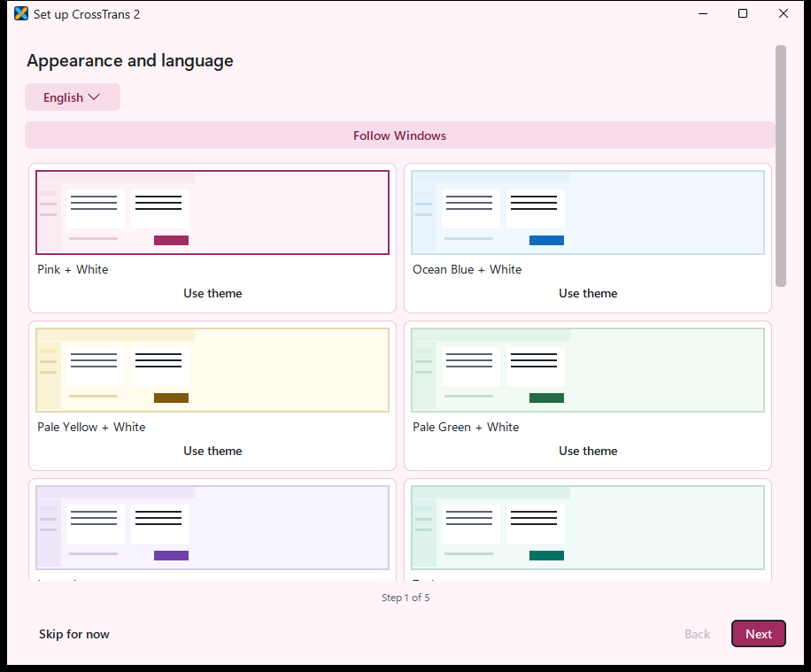
</p>

<p align="center">
  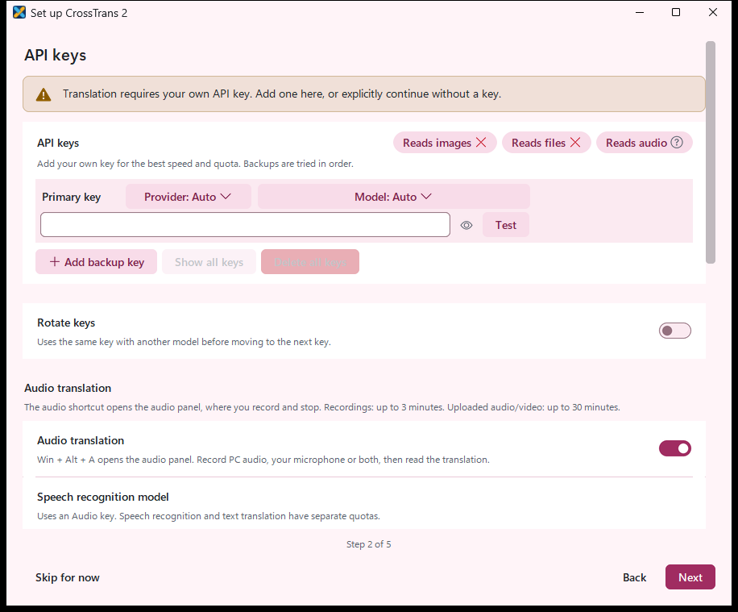
</p>

> You can re-open the Welcome Wizard anytime from **Settings → About → Show welcome again**.

---

## 3. Getting & Adding API Keys (Free Tiers Included)

CrossTrans 2 uses a **Bring Your Own Key (BYOK)** model: requests travel directly from your PC to your chosen AI provider. You control your quota, speed, model choice, and privacy.

### Recommended Free-Tier Providers to Start With

| Provider | Best For | Key Prefix | Where to Get a Key |
| --- | --- | --- | --- |
| **Google Gemini** | All-in-one: Text, **Screenshot OCR**, **PDF/Documents**, and **Audio** | `AIza...` or `AQ....` | [Google AI Studio](https://aistudio.google.com/apikey) |
| **Groq** | Ultra-fast text translation & **Whisper speech recognition (Audio)** | `gsk_...` | [Groq Console](https://console.groq.com/keys) |
| **OpenRouter** | Access to many free (`:free`) & paid models from one key | `sk-or-v1-...` | [OpenRouter Keys](https://openrouter.ai/keys) |
| **OpenAI / Anthropic / DeepSeek / xAI / Mistral / etc.** | Premium quality or existing developer credits | varies | Your provider's API dashboard |

### Step-by-Step: Adding & Testing Your Keys
1. Open **Settings → API keys** (from the top bar or tray menu).
2. Paste your API key into the **Primary key** box.
3. Leave **Provider** and **Model** on **Auto** for providers with recognizable prefixes (`AIza...`, `AQ....`, `gsk_...`, `sk-ant-...`, `sk-or-v1-...`, `sk-proj-...`, `xai-...`, `hf_...`, `csk-...`, `pplx-...`).
   - **Important:** If your key uses a generic prefix (`sk-...` shared by legacy OpenAI, DeepSeek, Together, SiliconFlow, or a bare UUID like SambaNova/Mistral), select the **Provider** manually from the dropdown so CrossTrans knows where to send your key.
4. Click **Test**. CrossTrans verifies the key, detects the fastest working model, and updates the **API Capabilities** badges (*Reads images*, *Reads files*, *Reads audio*).
5. **Pro Tip — Add Backup Keys:** Click **+ Add backup key** to add a second free key (for example, Gemini as Primary + Groq as Backup 1). Drag rows by their grip handle to change priority, and turn on **Rotate keys** if you want CrossTrans to try alternate models on the same key before switching to the next backup key.

<p align="center">
  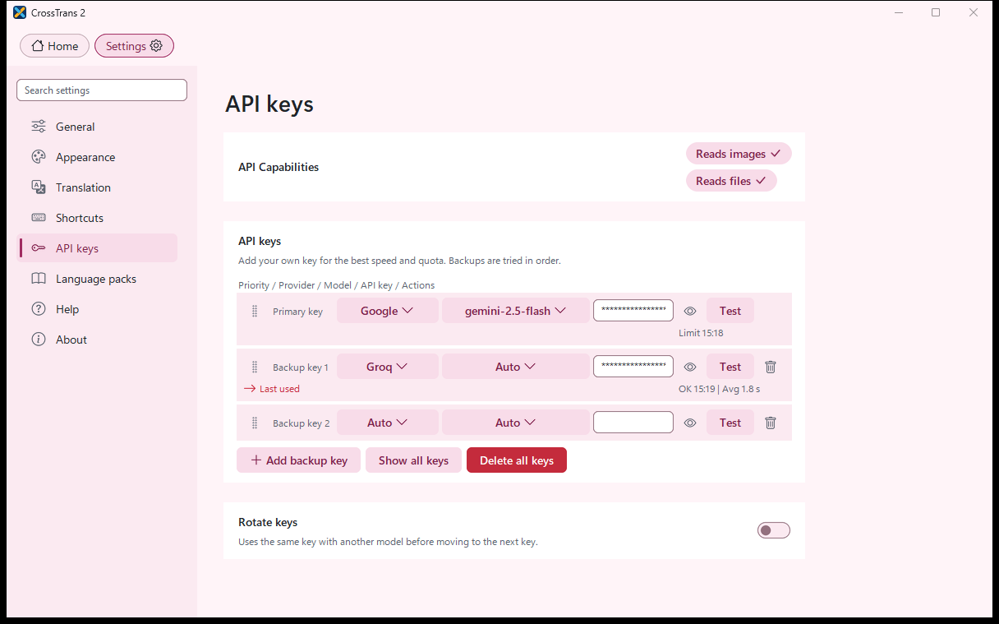
</p>

> **Security Note:** Keys are encrypted using Windows DPAPI. Clicking the eye icon or **Show all keys** triggers a native **Windows Hello / PIN / Password** confirmation prompt so nobody walking past your desk can read your keys.

---

## 4. Quick Translate & In-Place Replace

Quick Translate lets you translate text in **any Windows application** without switching windows.

### How to Use Quick Translate
1. **Select text** in any app (Chrome, Edge, PDF viewer, Word, Excel, Slack, VS Code, etc.).
2. Press a translation shortcut:
   - `Win + Alt + V` → **Vietnamese**
   - `Win + Alt + E` → **English**
   - `Win + Alt + J` → **Japanese**
   - `Win + Alt + C` → **Chinese (Simplified)**
3. A compact popup appears beside your cursor showing the original text (with Furigana for Japanese) and the translation.

<p align="center">
  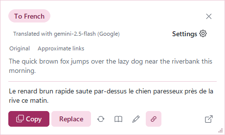
  &nbsp;&nbsp;
  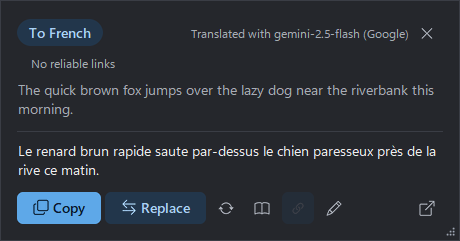
</p>

### Popup Action Buttons (Left to Right)
- **Copy** — Copies the translation to your clipboard.
- **Replace** — Pastes the translation directly over the text you selected in the source app.
  - By default, CrossTrans opens a **Replace Preview** showing your original text crossed out above the new translation. Click **Agree** to paste or **Cancel** to keep your text.
  - Prefer instant one-click replacement? Switch **Settings → Translation → Replace button** to **Replace immediately**.
- **Translate again (refresh icon)** — Re-runs the translation (bypasses cache).
- **Dictionary (book icon)** — Opens the interactive word picker for the translated passage.
- **Custom instruction (pencil icon)** — Re-translate the same text with a custom instruction (e.g., *"make it polite for a business email"*).
- **Linked Reading (link icon)** — Hover over a sentence in the original or translation to highlight the matching sentence on the other side.
- **Open Translator (arrow-out icon, far right)** — Sends the text to the full Translator window for longer edits or file attachments.
- Press **`Esc`** anytime to close the popup, or drag the bottom-right corner grip to resize it.

<p align="center">
  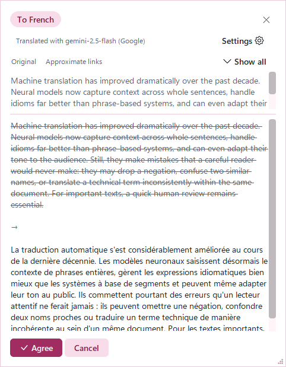
</p>

### Tips for Microsoft Excel & Tricky Desktop Apps
CrossTrans 2 uses a resilient 4-step capture pipeline designed to work smoothly with apps like **Microsoft Excel** (both single/multi-cell selection and in-cell / Formula Bar editing), **Adobe Acrobat**, **VS Code**, and **Electron apps**:
- When holding `Win + Alt + V/E/J/C`, just release the keys normally — CrossTrans waits briefly for modifier keys to clear before reading your selection so Excel's Alt-keytips don't intercept the capture.
- If a specialized app (e.g., an elevated Administrator window or DRM viewer) blocks automated copy, simply press **`Ctrl + C`** manually and then press the translate shortcut — CrossTrans can translate straight from your selection/clipboard.

---

## 5. Screenshot OCR & Translation

Translate text inside **images, videos, games, locked PDFs, slides, or UI menus** where you cannot highlight text.

1. Press **`Win + Alt + S`**.
2. Your screen dims (works across multiple monitors).
3. **Click and drag** a rectangle around the text you want to translate, then release.
   - Press **`Esc`** to cancel without capturing.
4. CrossTrans sends the cropped image to a vision-capable model (such as Gemini, GPT-4o/6, Claude, or Groq Qwen Vision) and shows the translation in the Quick Translate popup.
5. Click **Open Translator** in the popup if you want to keep the captured image attached and ask follow-up translation instructions.

<p align="center">
  
</p>

> **Requirement:** Make sure at least one saved API key shows **`Reads images ✓`** under **Settings → API keys**.

---

## 6. Audio & Video Translation

CrossTrans 2 can listen to **meetings, YouTube videos, podcasts, voice notes, or your own microphone**, and can also translate uploaded audio/video files.

### Opening the Audio Panel
- Press **`Win + Alt + A`** (or right-click the tray icon → **Audio panel**).
- The Audio panel opens right beside your cursor.

<p align="center">
  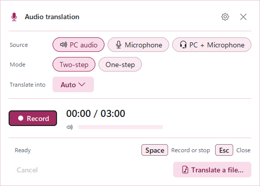
</p>

### Live Recording (Up to 3 Minutes per Clip)
1. Choose your **Source**:
   - **PC audio** — Captures system playback (e.g., Zoom/Teams calls, YouTube, anime, lectures) via Windows WASAPI loopback — no virtual cable needed!
   - **Microphone** — Captures your own speech.
   - **PC + Microphone** — Captures both sides of a conversation *(use headphones to prevent speaker echo into your microphone)*.
2. Choose **Mode**:
   - **Two-step** — Transcribes verbatim first, then translates (great for reading both transcript and translation).
   - **One-step** — Sends audio directly to a multimodal audio model for direct translation.
3. Choose **Translate into** (`Auto` follows your Translator window's target language).
4. Click **Record** (or press **`Space`**). Press **`Space`** or **Stop** when done — CrossTrans transcribes and translates automatically, and lets you replay the clip or choose whether to save it when closing.

### Translating Audio & Video Files (Up to 30 Minutes)
- Click **Translate a file...** in the Audio panel, **or** drag and drop an audio/video file (`.mp3`, `.wav`, `.m4a`, `.ogg`, `.flac`, `.mp4`, `.mkv`, `.webm`, etc.) into the main **Translator** window.
- Original files are never modified. Only the first audio track is extracted and translated.

### Configuring Audio Keys & Devices
Go to **Settings → API keys** and scroll to **Audio translation**:
- **Auto mode (default):** Automatically reuses your compatible main API keys (e.g., Groq Whisper or Google Gemini).
- **Custom audio key:** Optionally assign a dedicated speech-recognition key/model (useful because speech and text quotas are separate).
- **Audio shortcut behavior:** Choose **Open audio panel** or **Hold to record** (hold `Win + Alt + A` while speaking, release to translate!).
- **Devices & Noise Reduction:** Pick specific microphone/loopback devices, toggle microphone noise reduction, and configure your recording save policy (*Ask when closing*, *Discard*, or *Save*).

---

## 7. Translator Window, Files, PDFs & Subtitles

Open the full **Translator** window by double-clicking the tray icon, clicking **Open Translator** from a popup, or selecting **Home → Translate**.

<p align="center">
  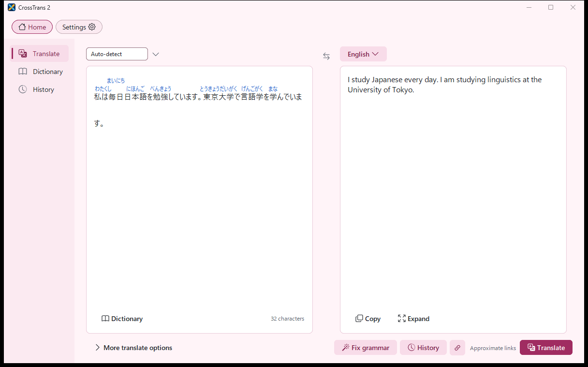
</p>

### Tone Presets & Custom Instructions
Click **`> More translate options`** at the bottom-left to pick a tone chip (**Formal**, **Casual**, **Concise**, **Natural**) or type any custom instruction (e.g., *"Translate as natural software UI strings"*).

<p align="center">
  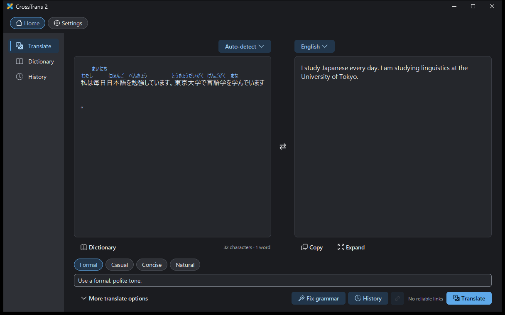
</p>

### Translating Documents, Scanned PDFs, Subtitles & Images
Drag and drop files directly onto the source area (or click **Attach file**):
- **Plain text & Markdown:** `.txt`, `.md`, code/config files
- **Word Documents:** `.docx`
- **PDFs:** `.pdf` — supports both text-based PDFs and **scanned PDFs** (with a vision-capable model)
- **Subtitles:** `.srt` — translates dialogue while **preserving timestamps**
- **Images:** `.png`, `.jpg`, `.jpeg`, `.webp`, `.bmp`, `.gif`
- **Audio & Video:** up to 30 minutes per file

<p align="center">
  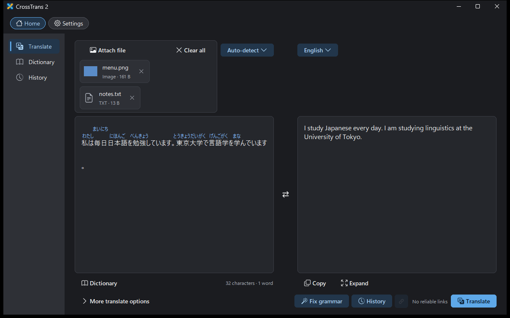
</p>

### Grammar Fix & Expanded Reading View
- Click **Fix grammar** (bottom-right) to proofread and polish text in its original language.
- Click **Expand** under the translation box to open a distraction-free, full-width reading view (`F11` toggles full-screen, `Ctrl + C` copies, `Esc` closes).

<p align="center">
  
</p>

---

## 8. Dictionary, Furigana & Linked Reading

### Automatic Japanese Furigana
Whenever Japanese text appears in the Translator, Quick Translate popup, History, or Dictionary, CrossTrans 2 automatically displays **Furigana readings** above kanji.
- Toggle anytime in **Settings → Translation → Show Furigana**.

### Interactive Dictionary & Phrase Builder
1. Click **Dictionary** in any translation popup or open **Home → Dictionary**.
2. Click **Select words from passage** to split the text into clickable word chips (with Furigana on Japanese words).
   - **Click** individual words, **Shift-click** a range, or **right-drag** words into the **Build a phrase** box below (or type your own phrase).
3. Click **Look up** to get a complete structured dictionary card: **Translation**, **Source Language**, **Definition**, **Word Type**, **Pronunciation**, **Synonyms**, **Antonyms**, and **Example sentences**.

<p align="center">
  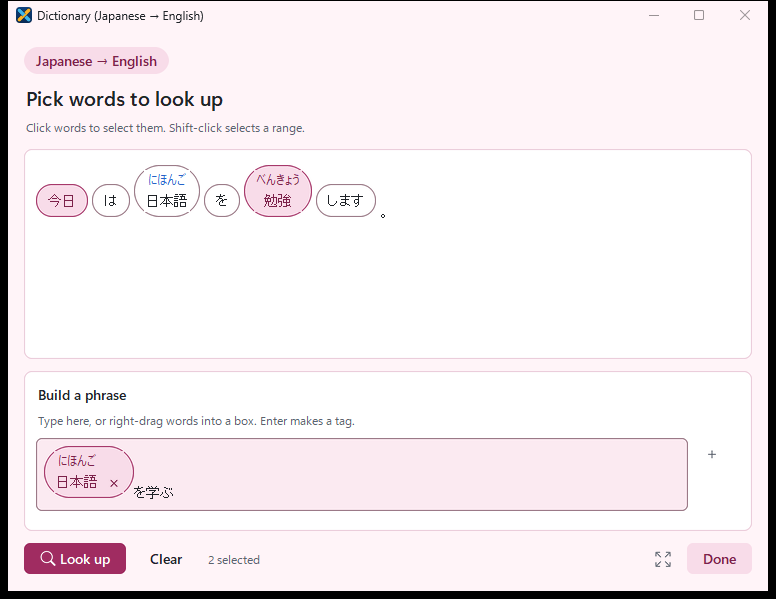
  &nbsp;&nbsp;
  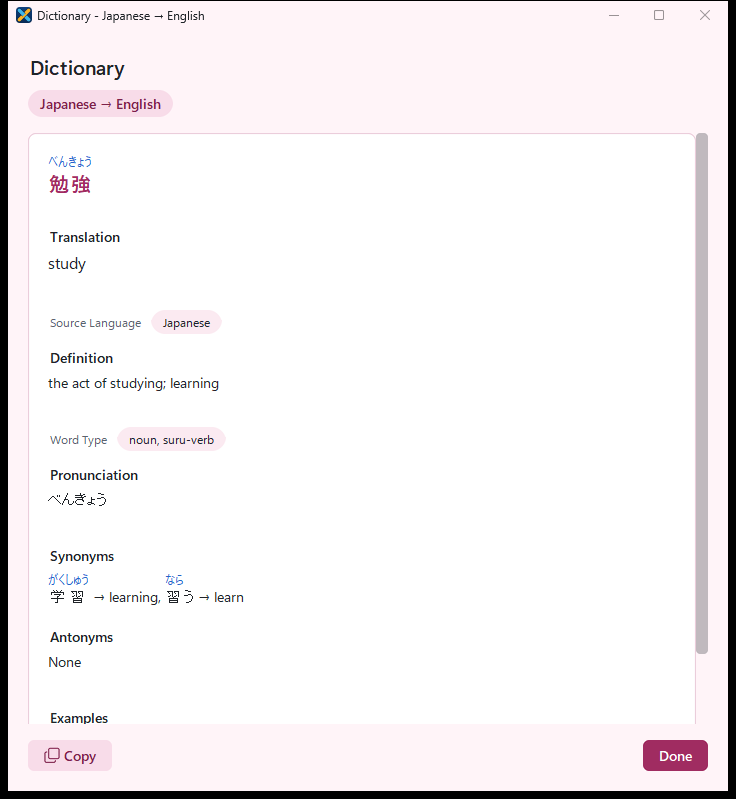
</p>

### Language Packs (Better Word Splitting)
For languages without spaces between words (Japanese, Chinese, Korean, Thai) and many European/Asian languages, install the corresponding offline tokenizer in **Settings → Language packs** so the Dictionary splits passages into accurate natural words.

<p align="center">
  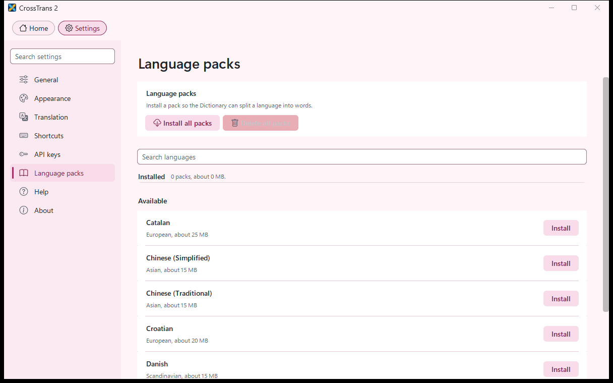
</p>

### Linked Reading
Turn on **Settings → Translation → Show Linked reading** to align sentences between the original text and translation. Hover over any sentence to highlight its counterpart on the opposite side.
> *Note: Linked Reading uses slightly more output tokens for alignment metadata. You can toggle the button visibility or disable it anytime in Translation settings.*

---

## 9. Translation History

Open **Home → History** to browse your last **200 translations** stored locally on your PC:
- **Search** across original text and translations in real time.
- **Filter** by language pair using the filter pills at the top.
- Click any item to view details, **Copy**, or **Open in Translate**.
- Pause history saving anytime in **Settings → General → Save translation history**, or wipe stored entries with **Clear all history**.

<p align="center">
  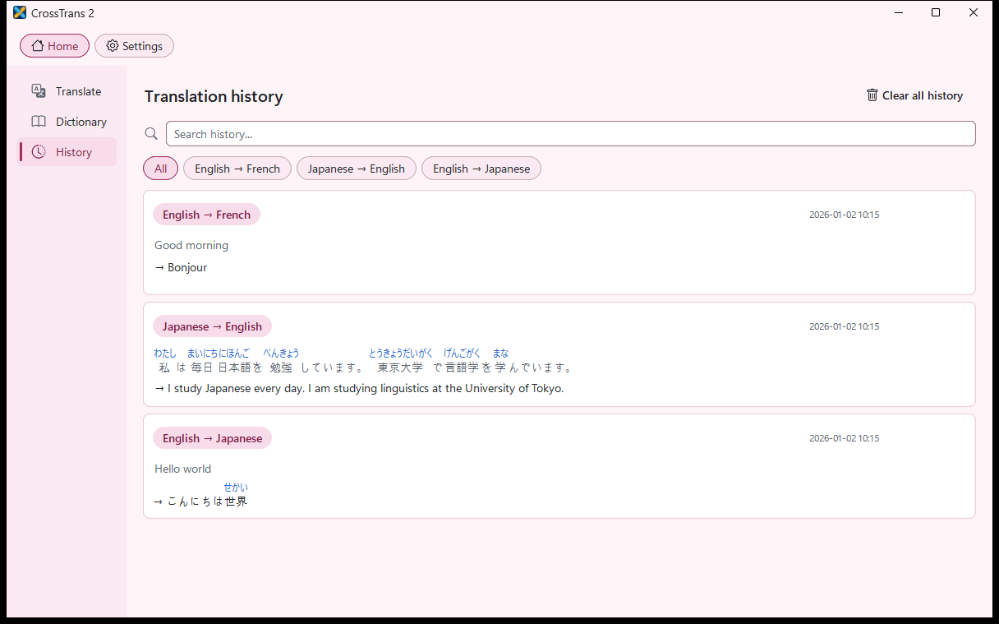
</p>

---

## 10. Customizing Shortcuts, Themes & Reading Aids

### Shortcuts (`Settings → Shortcuts`)
- Click **Change** next to any shortcut and press your desired key combination. CrossTrans automatically warns you if another shortcut or Windows app already claims that combination.
- Click **Add a new shortcut** to bind up to **4 extra target languages** beyond the default four.
- Toggle **Enable shortcuts** to pause all global hotkeys temporarily (e.g., while gaming).

<p align="center">
  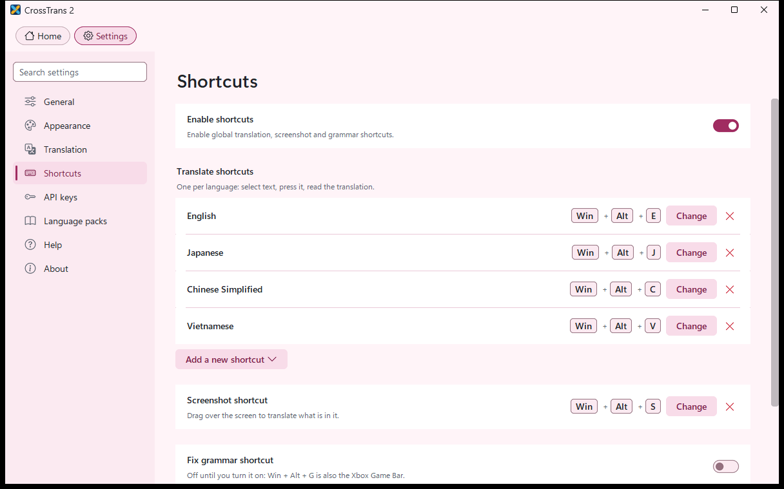
</p>

### Translation Preferences (`Settings → Translation`)
Configure your default target language, Screenshot OCR target language, Furigana, Linked Reading, Replace mode (*Preview first* vs *Replace immediately*), and the Fix Grammar button.

<p align="center">
  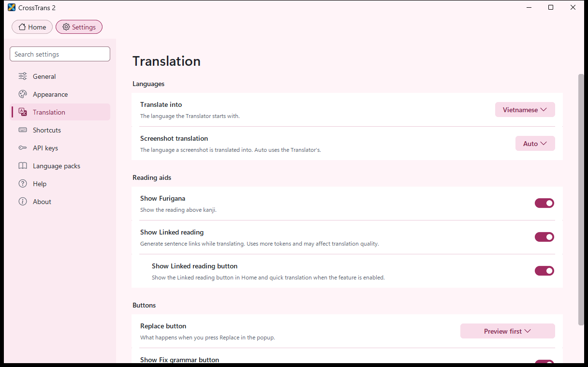
</p>

### Appearance (`Settings → Appearance`)
- Choose from **Light, Dark, Pastel**, or **Follow Windows** themes.
- Switch interface language between **English** and **Japanese (日本語)**.
- Adjust **Text size** (100% – 150%+) for comfortable reading on any screen.

<p align="center">
  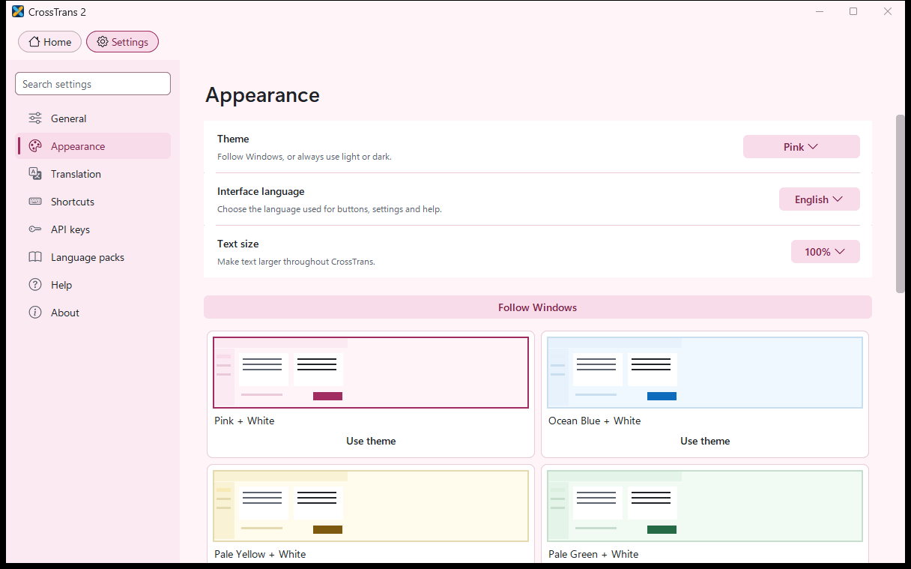
</p>

---

## 11. Auto-Updates, Privacy & Diagnostics

Open **Settings → About** to check your version, update CrossTrans 2, or export privacy-safe diagnostics.

<p align="center">
  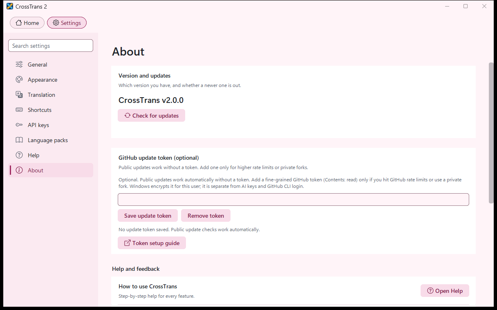
</p>

### Automatic Updates
- CrossTrans 2 checks **GitHub Releases** automatically on startup and once per day (toggle in **Settings → General → Check for updates automatically**), or anytime via **Check for updates**.
- **Public updates work out of the box without any token.** Before launching an update installer, CrossTrans verifies its **SHA-256 checksum**.
- **Optional GitHub Update Token:** You do **not** need to fill this in. It is only useful if you share a corporate IP that hits GitHub's 60 requests/hour unauthenticated rate limit, or if you run a private fork.

### Privacy & Diagnostics
- Click **Open diagnostics** (under **Settings → About**) to inspect runtime status, copy a sanitized bug report, or export logs for a GitHub issue.
- **API keys, GitHub tokens, and translation history/text are automatically excluded** from diagnostic reports and logs.
- Turn on **Verbose debug logging** only when troubleshooting an issue, then turn it back off afterward.

---

## Troubleshooting

### A hotkey (`Win + Alt + V/E/J/C/S/A`) does nothing
- Check **Settings → Shortcuts** — make sure **Enable shortcuts** is turned ON and check for any conflict warning underneath that row.
- Another app (e.g., Xbox Game Bar on `Win + Alt + G`, GPU overlay software, or another translator) may already hold the shortcut. Click **Change** and pick another combination.
- If the active window is running **as Administrator** while CrossTrans is running normally, Windows UIPI prevents standard apps from capturing or sending keystrokes to elevated windows.

### Quick Translate says *"No text selected"* in a specific app
- Ensure the text is actually highlighted before pressing the shortcut.
- Some apps (certain PDF viewers, remote desktop sessions, or protected fields) block automated copy shortcuts. Press **`Ctrl + C`** first, then press the translate shortcut.
- In **Microsoft Excel**, either select a cell normally or highlight text inside the Formula Bar, then press the shortcut and release the keys cleanly.

### Translation returns an error (401, 403, 429, or *"Choose Provider"*)
- **401 / Invalid API key:** Open **Settings → API keys**, re-paste your key carefully (without extra spaces), and click **Test**.
- **429 / Rate limit or quota exceeded:** Free-tier providers limit requests per minute/day. Wait a moment, or add a **Backup key** from a second provider (e.g., Gemini + Groq) so CrossTrans fails over automatically.
- **"Select a Provider for this key":** Some keys (legacy `sk-...`, Mistral, SambaNova UUIDs) don't have a unique prefix — pick the exact **Provider** from the dropdown instead of `Auto`.
- **Screenshot OCR or PDF fails:** Confirm that at least one active key has **`Reads images ✓`** or **`Reads files ✓`** in **Settings → API keys** (some text-only models do not accept images).

### Replace didn't paste into my app
- Keep the original text selected when pressing **Replace** → **Agree**.
- Read-only fields (like web pages or PDFs) cannot be overwritten, and a few apps block synthetic `Ctrl + V`. Don't worry — the translation is always copied to your clipboard so you can paste it manually with `Ctrl + V`.

### Audio recording captures silence
- For **PC audio**, make sure sound is actually playing through the playback device selected in **Settings → API keys → Audio devices**.
- For **Microphone**, verify Windows Privacy settings allow desktop apps to access your microphone (*Windows Settings → Privacy & security → Microphone*).
- If using **PC + Microphone**, wear headphones so speaker playback doesn't echo back into your mic.

### CrossTrans won't open when I double-click it
- Only one instance of CrossTrans 2 runs at a time. Check the **Windows System Tray** (click the `^` arrow near the clock) — it is likely already running in the background! Right-click the icon to open the Translator window or Settings.

### Still need help?
- Open **Settings → About → Open diagnostics**, click **Report on GitHub**, and paste the sanitized report into a new [Bug Report](https://github.com/Masaru-urasaM/CrossTrans2/issues/new/choose).
