# CrossTrans 2 — Hướng dẫn sử dụng chi tiết

> **English:** Read the [English User Guide](USER_GUIDE.md).

Chào mừng bạn đến với **CrossTrans 2**! Tài liệu này hướng dẫn từng bước từ lúc cài đặt, cách lấy **API key miễn phí**, cho đến cách sử dụng toàn bộ tính năng và xử lý các lỗi thường gặp.

---

## Mục lục

1. [Cài đặt & Lưu ý Windows SmartScreen](#1-cài-đặt--lưu-ý-windows-smartscreen)
2. [Thiết lập lần đầu (Welcome Wizard)](#2-thiết-lập-lần-đầu-welcome-wizard)
3. [Cách lấy & thêm API Key (Có gói miễn phí)](#3-cách-lấy--thêm-api-key-có-gói-miễn-phí)
4. [Dịch nhanh (Quick Translate) & Thay thế trực tiếp (Replace)](#4-dịch-nhanh-quick-translate--thay-thế-trực-tiếp-replace)
5. [Dịch ảnh chụp màn hình (Screenshot OCR)](#5-dịch-ảnh-chụp-màn-hình-screenshot-ocr)
6. [Dịch âm thanh trực tiếp & File âm thanh/video](#6-dịch-âm-thanh-trực-tiếp--file-âm-thanhvideo)
7. [Cửa sổ dịch đầy đủ, dịch Tài liệu, PDF & Phụ đề](#7-cửa-sổ-dịch-đầy-đủ-dịch-tài-liệu-pdf--phụ-đề)
8. [Từ điển tương tác, Furigana & Đọc đối chiếu (Linked Reading)](#8-từ-điển-tương-tác-furigana--đọc-đối-chiếu-linked-reading)
9. [Lịch sử dịch (History)](#9-lịch-sử-dịch-history)
10. [Tùy chỉnh Phím tắt, Giao diện & Tiện ích đọc](#10-tùy-chỉnh-phím-tắt-giao-diện--tiện-ích-đọc)
11. [Tự động cập nhật, Quyền riêng tư & Chẩn đoán lỗi](#11-tự-động-cập-nhật-quyền-riêng-tư--chẩn-đoán-lỗi)
12. [Câu hỏi thường gặp & Xử lý sự cố (Troubleshooting)](#troubleshooting)

---

## 1. Cài đặt & Lưu ý Windows SmartScreen

### Yêu cầu hệ thống
- **Hệ điều hành:** Windows 10 hoặc Windows 11 (64-bit).
- **Kết nối Internet** và ít nhất **1 API key AI** (bạn có thể lấy miễn phí trong 1 phút — xem [Mục 3](#3-cách-lấy--thêm-api-key-có-gói-miễn-phí)).

### Cài đặt bằng bộ cài Setup (Khuyên dùng)
1. Tải file **`CrossTrans2Setup_v2.0.0.exe`** từ trang [GitHub Releases mới nhất](https://github.com/Masaru-urasaM/CrossTrans2/releases/latest).
2. *(Tùy chọn)* Nếu muốn kiểm tra tính toàn vẹn của file tải về so với **`SHA256SUMS.txt`**, mở PowerShell và chạy:
   ```powershell
   Get-FileHash .\CrossTrans2Setup_v2.0.0.exe -Algorithm SHA256
   ```
3. Nháy đúp **`CrossTrans2Setup_v2.0.0.exe`** và làm theo hướng dẫn trên màn hình.
   - Bộ cài sẽ tự tạo lối tắt Start Menu, hỗ trợ tự động khởi động cùng Windows, gỡ cài đặt sạch sẽ và tự động cập nhật phiên bản mới.
4. Sau khi mở, CrossTrans 2 sẽ chạy gọn trong **Khay hệ thống (System Tray)** ở góc dưới bên phải thanh Taskbar (bấm mũi tên `^` nếu bị ẩn). Bạn có thể **nhấp chuột phải** vào biểu tượng để mở nhanh **Translate**, **Audio panel**, **Settings** hoặc **Exit**.

### Vì sao Windows hiện cảnh báo *"Windows protected your PC"* (SmartScreen)?
CrossTrans 2 là phần mềm mã nguồn mở miễn phí, chưa mua chứng chỉ ký số (Code Signing Certificate) thương mại nên Windows Defender SmartScreen có thể hiện cảnh báo ở lần chạy đầu tiên.
- Chỉ cần đảm bảo bạn tải đúng từ `https://github.com/Masaru-urasaM/CrossTrans2/releases` (và có thể đối chiếu mã `SHA256SUMS.txt`).
- Bấm **More info** (Thông tin thêm) → chọn **Run anyway** (Vẫn chạy) để tiến hành cài đặt bình thường.

---

## 2. Thiết lập lần đầu (Welcome Wizard)

Lần đầu tiên mở CrossTrans 2, trình hướng dẫn **Set up CrossTrans 2** sẽ giúp bạn cấu hình nhanh:

1. **Giao diện & Ngôn ngữ hiển thị:** Chọn ngôn ngữ giao diện (**English** hoặc **日本語**) và chủ đề màu sắc (Hồng, Xanh dương, Vàng nhạt, Xanh lá nhạt, Sáng, Tối hoặc **Follow Windows**).
2. **Thêm API Key & Âm thanh:** Dán API key chính và bấm **Test** để kiểm tra ngay (hoặc bấm **Skip for now** để thêm sau trong **Settings → API keys**).
3. **Xem phím tắt & Dùng thử bản dịch đầu tiên.**

<p align="center">
  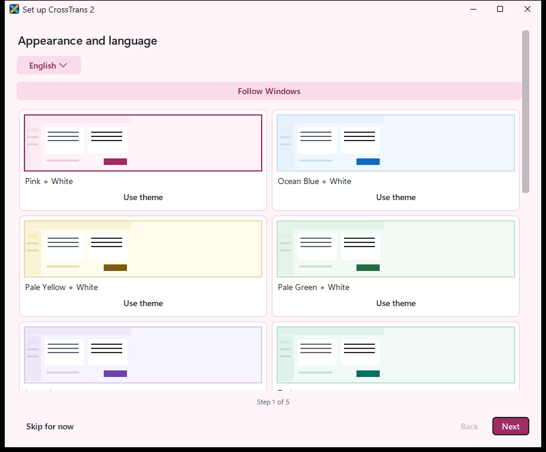
</p>

<p align="center">
  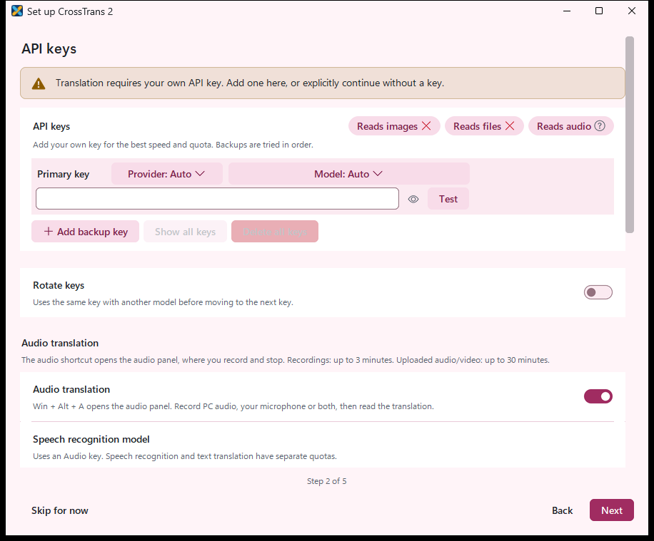
</p>

> Bạn luôn có thể mở lại trình hướng dẫn này trong **Settings → About → Show welcome again**.

---

## 3. Cách lấy & thêm API Key (Có gói miễn phí)

CrossTrans 2 hoạt động theo mô hình **Bring Your Own Key (BYOK)** — ứng dụng gửi yêu cầu dịch trực tiếp từ máy của bạn đến nhà cung cấp AI bạn chọn, không đi qua máy chủ trung gian và không lưu trữ văn bản của bạn.

### Các nhà cung cấp có gói Miễn phí (Khuyên dùng cho người mới)

| Nhà cung cấp | Điểm mạnh | Tiền tố Key | Link tạo Key |
| --- | --- | --- | --- |
| **Google Gemini** | Toàn diện nhất: Dịch văn bản, **Chụp ảnh OCR**, **PDF/Tài liệu**, và **Âm thanh** | `AIza...` hoặc `AQ....` | [Google AI Studio](https://aistudio.google.com/apikey) |
| **Groq** | Tốc độ siêu nhanh cho văn bản & nhận dạng giọng nói **Whisper (Audio)** | `gsk_...` | [Groq Console](https://console.groq.com/keys) |
| **OpenRouter** | Dùng 1 key duy nhất để truy cập nhiều model miễn phí (`:free`) và trả phí | `sk-or-v1-...` | [OpenRouter Keys](https://openrouter.ai/keys) |
| **OpenAI / Anthropic / DeepSeek / xAI / Mistral / ...** | Chất lượng cao hoặc tận dụng sẵn hạn mức API bạn đang có | tùy hãng | Trang quản lý API của hãng |

### Các bước thêm và kiểm tra API Key
1. Mở **Settings → API keys** (từ thanh trên cùng hoặc menu khay hệ thống).
2. Dán khóa API vào ô **Primary key**.
3. Giữ nguyên **Provider: Auto** và **Model: Auto** với các key có tiền tố đặc trưng (`AIza...`, `AQ....`, `gsk_...`, `sk-ant-...`, `sk-or-v1-...`, `sk-proj-...`, `xai-...`, `hf_...`, `csk-...`, `pplx-...`).
   - **Lưu ý quan trọng:** Với các key không có tiền tố phân biệt rõ (như key `sk-...` cũ của OpenAI/DeepSeek/Together/SiliconFlow hoặc chuỗi UUID của SambaNova/Mistral), bạn cần **chọn đúng tên Provider** trong danh sách thả xuống thay vì để `Auto`.
4. Bấm **Test**. CrossTrans sẽ kiểm tra kết nối, tự chọn model chạy tốt nhất và cập nhật huy hiệu khả năng ở góc trên (**Reads images**, **Reads files**, **Reads audio**).
5. **Mẹo hay — Thêm Backup key (Key dự phòng):** Bấm **+ Add backup key** để thêm key thứ 2 (ví dụ: Google Gemini làm Primary key + Groq làm Backup key 1). Khi key chính hết hạn mức hoặc bị giới hạn tốc độ, CrossTrans sẽ tự động chuyển sang key dự phòng! Bạn có thể kéo thả biểu tượng 6 chấm đầu dòng để đổi thứ tự ưu tiên, và bật **Rotate keys** để thử model khác trên cùng 1 key trước khi sang key dự phòng.

<p align="center">
  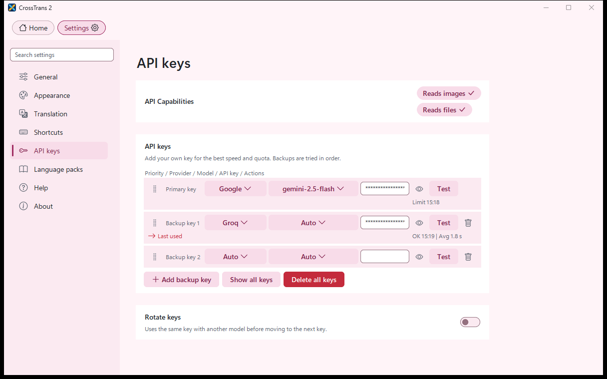
</p>

> **Bảo mật:** Mọi API key đều được mã hóa theo từng tài khoản Windows bằng **Windows DPAPI**. Khi bấm biểu tượng con mắt hoặc **Show all keys**, Windows sẽ yêu cầu xác thực **Windows Hello / PIN / Mật khẩu** để tránh người khác xem trộm key trên máy bạn.

---

## 4. Dịch nhanh (Quick Translate) & Thay thế trực tiếp (Replace)

Tính năng Dịch nhanh cho phép bạn dịch văn bản ở **bất kỳ phần mềm Windows nào** mà không cần chuyển cửa sổ.

### Cách dùng
1. **Bôi đen văn bản** trong trình duyệt, PDF, Word, Excel, Zalo/Slack/Teams, VS Code...
2. Bấm phím tắt tương ứng với ngôn ngữ muốn dịch sang:
   - `Win + Alt + V` → **Tiếng Việt**
   - `Win + Alt + E` → **Tiếng Anh**
   - `Win + Alt + J` → **Tiếng Nhật**
   - `Win + Alt + C` → **Tiếng Trung (Giản thể)**
3. Một cửa sổ popup nhỏ gọn sẽ hiện ngay cạnh con trỏ chuột với cả bản gốc (có Furigana nếu là tiếng Nhật) và bản dịch.

<p align="center">
  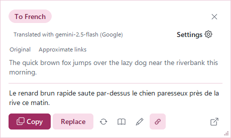
  &nbsp;&nbsp;
  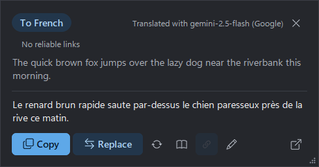
</p>

### Ý nghĩa các nút trên Popup (từ trái sang phải)
- **Copy:** Sao chép bản dịch vào clipboard.
- **Replace:** Dán bản dịch thay thế trực tiếp đoạn văn bản bạn vừa bôi đen.
  - Mặc định sẽ mở màn hình **Xem trước thay thế (Replace Preview)** hiển thị bản gốc bị gạch ngang và bản dịch mới bên dưới — bấm **Agree** để xác nhận hoặc **Cancel** để giữ nguyên.
  - Nếu muốn dán ngay lập tức không qua bước xem trước, vào **Settings → Translation → Replace button** và chọn **Replace immediately**.
- **Dịch lại (biểu tượng xoay vòng):** Yêu cầu AI dịch mới lại (không dùng cache cũ).
- **Từ điển (biểu tượng quyển sách):** Mở trình chọn từ để tra nghĩa chi tiết ngay trên đoạn vừa dịch.
- **Yêu cầu riêng (biểu tượng cây bút):** Nhập ghi chú để dịch lại theo văn phong bạn muốn (ví dụ: *"dịch lịch sự để gửi email khách hàng"*).
- **Đọc đối chiếu (biểu tượng mắt xích):** Rê chuột vào từng câu ở bản gốc hoặc bản dịch để tô sáng câu tương ứng ở khung còn lại.
- **Mở cửa sổ dịch lớn (biểu tượng mũi tên góc phải):** Đưa toàn bộ nội dung sang cửa sổ Translator đầy đủ.
- Bấm **`Esc`** để đóng nhanh popup, hoặc kéo góc dưới bên phải để phóng to/thu nhỏ popup.

<p align="center">
  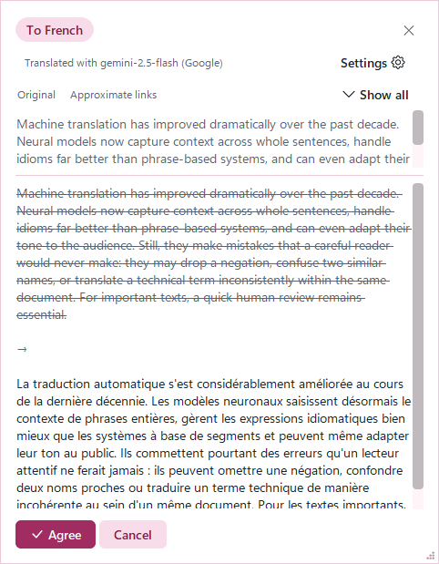
</p>

### Mẹo dùng trên Microsoft Excel và các ứng dụng đặc thù
CrossTrans 2 sử dụng cơ chế thu thập văn bản 4 bước tối ưu cho các phần mềm khó tính như **Microsoft Excel** (cả chọn ô lẫn đang sửa chữ trong Formula Bar), **Adobe PDF**, **VS Code**:
- Khi bấm `Win + Alt + V/E/J/C`, bạn chỉ cần thả phím tự nhiên — CrossTrans tự chờ phím `Alt`/`Win` nhả hoàn toàn trước khi sao chép vùng chọn, tránh hiện tượng bị kẹt menu `Alt` của Excel.
- Nếu ứng dụng đặc biệt nào đó (ví dụ ứng dụng chạy bằng quyền Administrator hoặc trình xem có khóa bảo vệ) chặn lệnh copy tự động, bạn chỉ cần bấm **`Ctrl + C`** trước rồi bấm phím tắt dịch.

---

## 5. Dịch ảnh chụp màn hình (Screenshot OCR)

Dùng khi văn bản nằm trong **hình ảnh, video, game, file PDF scan hoặc giao diện phần mềm** không thể bôi đen được.

1. Bấm **`Win + Alt + S`**.
2. Toàn màn hình sẽ tối nhẹ lại (hỗ trợ cả hệ thống nhiều màn hình).
3. **Kéo chuột khoanh vùng** đoạn chữ cần dịch rồi thả tay.
   - Bấm **`Esc`** bất cứ lúc nào để hủy.
4. CrossTrans tự đọc chữ trong ảnh (OCR) bằng AI có hỗ trợ thị giác (như Google Gemini, GPT-4o/6, Claude, Groq Qwen Vision) và hiện bản dịch ngay tại chỗ.
5. Nếu muốn lưu lại ảnh để hỏi thêm hoặc dịch lại với ghi chú riêng, bấm nút **Open Translator** trên popup.

<p align="center">
  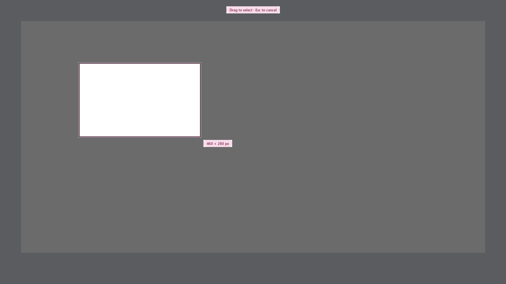
</p>

> **Lưu ý:** Cần có ít nhất 1 API key hiển thị **`Reads images ✓`** trong **Settings → API keys**.

---

## 6. Dịch âm thanh trực tiếp & File âm thanh/video

CrossTrans 2 có thể nghe và dịch trực tiếp **cuộc họp online, video YouTube, bài giảng, giọng nói qua micro**, đồng thời hỗ trợ dịch cả **file âm thanh và video** có sẵn.

### Mở bảng điều khiển âm thanh (Audio Panel)
- Bấm **`Win + Alt + A`** (hoặc nhấp chuột phải biểu tượng khay hệ thống → **Audio panel**).
- Bảng Audio nhỏ gọn sẽ hiện ngay gần vị trí con trỏ chuột.

<p align="center">
  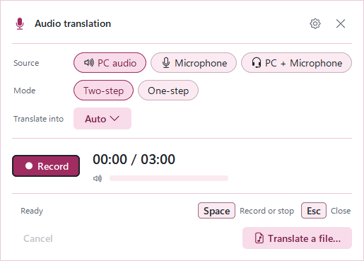
</p>

### Ghi âm và dịch trực tiếp (tối đa 3 phút / lượt)
1. Chọn **Nguồn thu (Source):**
   - **PC audio:** Thu trực tiếp âm thanh đang phát ra loa máy tính (họp Zoom/Teams, YouTube, phim, bài giảng) qua Windows WASAPI loopback — không cần cài thêm phần mềm tạo cáp ảo!
   - **Microphone:** Thu giọng nói từ micro của bạn.
   - **PC + Microphone:** Thu song song cả hai chiều *(nên đeo tai nghe để âm thanh loa không bị dội ngược vào micro)*.
2. Chọn **Chế độ xử lý (Mode):**
   - **Two-step:** Chuyển giọng nói thành văn bản gốc trước rồi mới dịch (tiện đối chiếu cả lời gốc lẫn bản dịch).
   - **One-step:** Gửi âm thanh trực tiếp cho model AI đa phương thức để dịch thẳng trong 1 bước.
3. Chọn ngôn ngữ đích tại **Translate into** (`Auto` sẽ dùng theo ngôn ngữ đích của cửa sổ dịch chính).
4. Bấm **Record** (hoặc bấm phím **`Space`**) để bắt đầu, bấm **`Space`** lần nữa để dừng và dịch. Sau khi có kết quả, bạn có thể bấm nút phát lại đoạn thu âm và chọn lưu hoặc xóa khi đóng.

### Dịch file âm thanh / video có sẵn (tối đa 30 phút)
- Bấm nút **Translate a file...** trên bảng Audio, **hoặc** kéo thả trực tiếp file (`.mp3`, `.wav`, `.m4a`, `.ogg`, `.flac`, `.mp4`, `.mkv`, `.webm`...) vào cửa sổ **Translator**.
- File gốc hoàn toàn không bị chỉnh sửa; ứng dụng sẽ tự trích xuất track âm thanh đầu tiên để dịch.

### Tùy chỉnh Key Audio, Thiết bị & Chế độ Giữ phím để ghi
Vào **Settings → API keys**, kéo xuống mục **Audio translation**:
- **Chế độ Auto (mặc định):** Tự tận dụng API key chính tương thích (ví dụ Groq Whisper hoặc Google Gemini).
- **Custom key:** Bạn có thể cấu hình riêng một key/model chuyên nhận dạng giọng nói nếu muốn tách hạn mức riêng với dịch văn bản.
- **Audio shortcut:** Chọn giữa **Mở bảng Audio** hoặc **Giữ phím để ghi âm (Hold to record)** (giữ `Win + Alt + A` khi nói, thả ra là tự dịch!).
- **Thiết bị & Lọc ồn:** Chọn đúng micro / loa cần thu, bật giảm nhiễu micro, và chọn chính sách lưu file ghi âm (*Hỏi khi đóng*, *Xóa tự động* hoặc *Lưu ra thư mục*).

---

## 7. Cửa sổ dịch đầy đủ, dịch Tài liệu, PDF & Phụ đề

Mở cửa sổ **Translator** bằng cách nháy đúp biểu tượng ở khay hệ thống, bấm nút **Open Translator** trên popup, hoặc chọn **Home → Translate**.

<p align="center">
  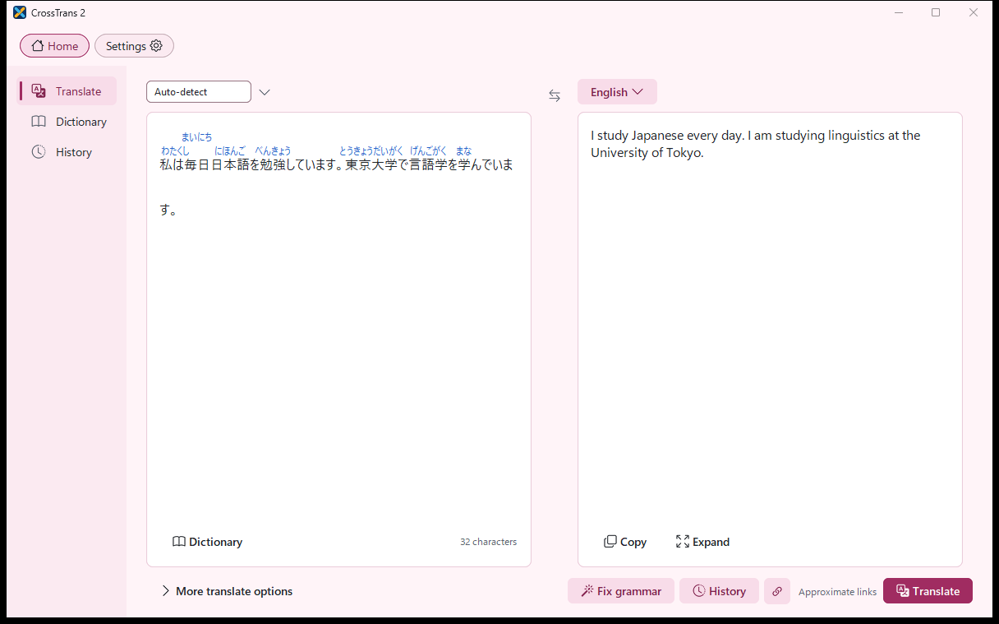
</p>

### Chọn văn phong & Yêu cầu dịch nâng cao
Bấm **`> More translate options`** ở góc dưới bên trái để chọn nhanh giọng văn (**Formal** - trang trọng, **Casual** - thân mật, **Concise** - ngắn gọn, **Natural** - tự nhiên) hoặc tự gõ yêu cầu tùy ý.

<p align="center">
  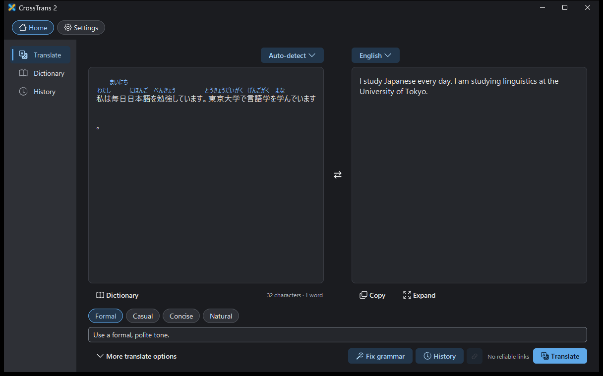
</p>

### Dịch tài liệu, PDF scan, phụ đề & hình ảnh
Kéo thả tệp trực tiếp vào khung nhập văn bản (hoặc bấm **Attach file**):
- **Văn bản & Code:** `.txt`, `.md`...
- **Tài liệu Word:** `.docx`
- **Tài liệu PDF:** `.pdf` — hỗ trợ cả file PDF văn bản lẫn **PDF dạng ảnh scan** (khi dùng model hỗ trợ ảnh/file)
- **Phụ đề phim:** `.srt` — dịch lời thoại nhưng **giữ nguyên mốc thời gian (timestamps)**
- **Hình ảnh:** `.png`, `.jpg`, `.jpeg`, `.webp`, `.bmp`, `.gif`
- **Âm thanh & Video:** tối đa 30 phút mỗi tệp

<p align="center">
  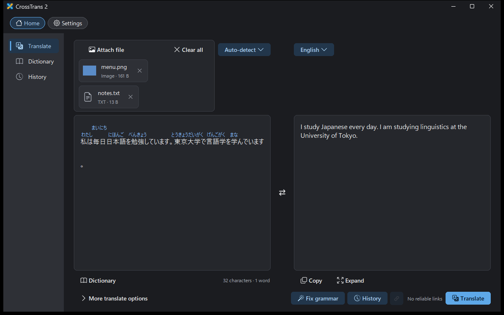
</p>

### Sửa lỗi ngữ pháp & Chế độ đọc mở rộng
- Bấm **Fix grammar** ở góc dưới bên phải để kiểm tra chính tả và diễn đạt lại câu cho tự nhiên ngay trong ngôn ngữ gốc.
- Bấm **Expand** dưới khung kết quả để mở cửa sổ đọc toàn màn hình rộng rãi (`F11` bật/tắt toàn màn hình, `Ctrl + C` sao chép, `Esc` đóng).

<p align="center">
  
</p>

---

## 8. Từ điển tương tác, Furigana & Đọc đối chiếu (Linked Reading)

### Tự động gắn phiên âm Furigana cho tiếng Nhật
Mỗi khi có chữ tiếng Nhật (Kanji) xuất hiện ở cửa sổ dịch, popup dịch nhanh, lịch sử hoặc từ điển, CrossTrans 2 tự động hiển thị phiên âm **Furigana** ngay phía trên chữ Hán.
- Bạn có thể bật/tắt trong **Settings → Translation → Show Furigana**.

### Từ điển tương tác & Ghép cụm từ
1. Bấm nút **Dictionary** trên popup dịch nhanh hoặc mở **Home → Dictionary**.
2. Bấm **Select words from passage** để tách cả đoạn văn thành các thẻ từ bấm được (kèm Furigana cho tiếng Nhật).
   - **Click** từng từ, **Shift + Click** để chọn nguyên đoạn, hoặc **kéo chuột phải** thả từ vào khung **Build a phrase** bên dưới (hoặc tự gõ từ/cụm từ muốn tra).
3. Bấm **Look up** để nhận bảng tra cứu chi tiết gồm: **Nghĩa dịch**, **Ngôn ngữ gốc**, **Định nghĩa**, **Từ loại**, **Cách phát âm**, **Từ đồng nghĩa**, **Từ trái nghĩa** và **Câu ví dụ**.

<p align="center">
  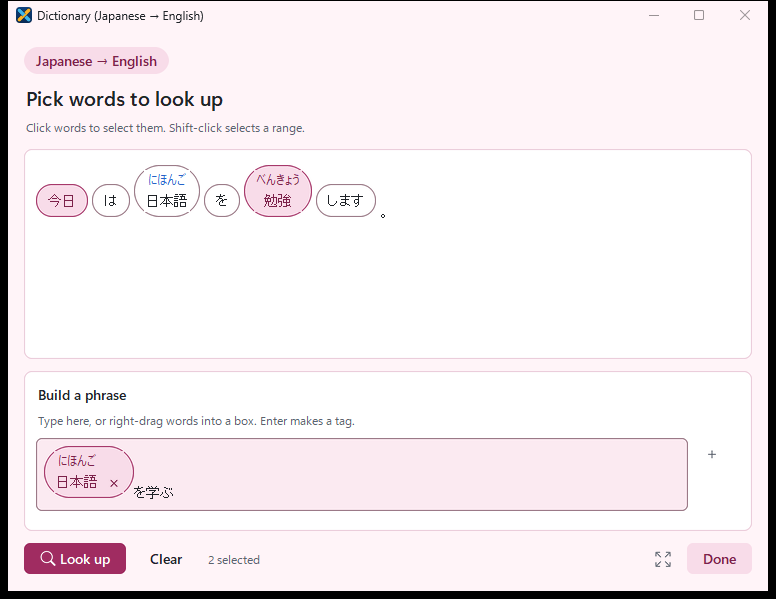
  &nbsp;&nbsp;
  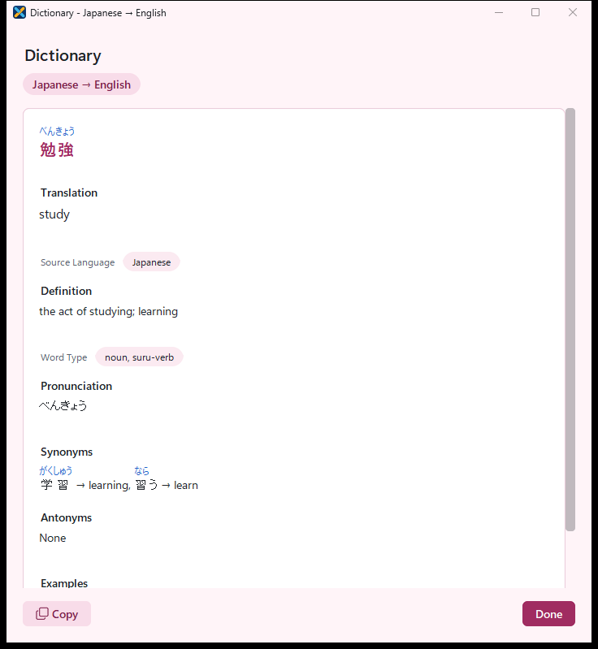
</p>

### Gói ngôn ngữ (Language Packs) giúp tách từ chuẩn xác
Với các ngôn ngữ không có dấu cách giữa các từ (tiếng Nhật, Trung, Hàn, Thái...) và hơn 20 ngôn ngữ khác, bạn nên vào **Settings → Language packs** để tải gói tách từ offline tương ứng — từ điển sẽ tách đúng từng từ vựng tự nhiên thay vì tách từng chữ rời rạc.

<p align="center">
  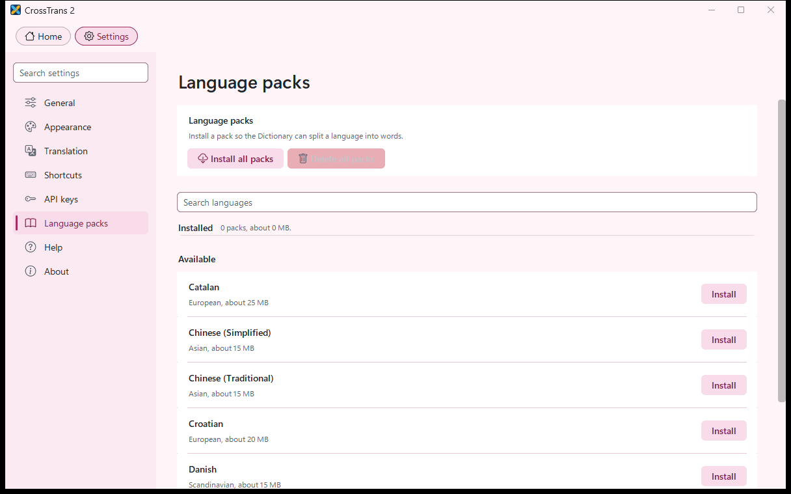
</p>

### Đọc đối chiếu từng câu (Linked Reading)
Bật **Settings → Translation → Show Linked reading** để liên kết câu giữa bản gốc và bản dịch. Chỉ cần di chuột vào bất kỳ câu nào, câu tương ứng bên khung đối diện sẽ tự động nổi bật lên — cực kỳ tiện khi đọc tài liệu dài hoặc học ngoại ngữ.
> *Lưu ý: Tính năng này dùng thêm một lượng nhỏ token để AI tạo dữ liệu đối chiếu. Bạn có thể bật/tắt tùy ý trong cài đặt Translation.*

---

## 9. Lịch sử dịch (History)

Mở **Home → History** để xem lại tối đa **200 bản dịch gần nhất** được lưu hoàn toàn trên máy của bạn:
- **Tìm kiếm nhanh** theo cả văn bản gốc lẫn bản dịch.
- **Lọc theo cặp ngôn ngữ** bằng các nút lọc ngay phía trên.
- Nhấp vào từng mục để xem chi tiết, **Copy** hoặc **Open in Translate**.
- Bạn có thể tạm dừng lưu lịch sử trong **Settings → General → Save translation history**, hoặc xóa sạch bằng nút **Clear all history**.

<p align="center">
  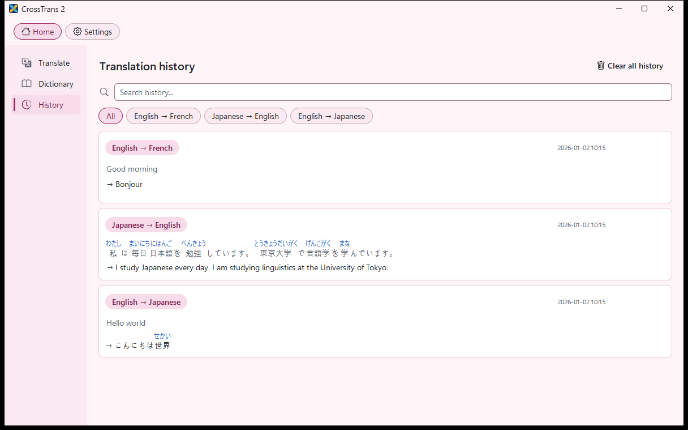
</p>

---

## 10. Tùy chỉnh Phím tắt, Giao diện & Tiện ích đọc

### Phím tắt (`Settings → Shortcuts`)
- Bấm **Change** cạnh phím tắt bất kỳ rồi nhấn tổ hợp phím mới. CrossTrans tự cảnh báo nếu tổ hợp phím đó bị trùng hoặc đang được phần mềm khác chiếm dụng.
- Bấm **Add a new shortcut** để thêm tối đa **4 ngôn ngữ dịch nhanh** nữa ngoài 4 ngôn ngữ mặc định.
- Tắt công tắc **Enable shortcuts** nếu bạn muốn tạm tắt toàn bộ phím tắt toàn cục (ví dụ khi đang chơi game).

<p align="center">
  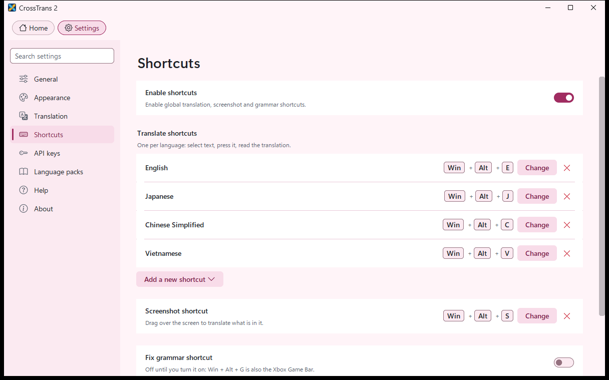
</p>

### Cài đặt Dịch (`Settings → Translation`)
Tùy chỉnh ngôn ngữ đích mặc định, ngôn ngữ dịch cho ảnh chụp màn hình, bật/tắt Furigana, Linked Reading, chế độ nút Replace (*Xem trước* hay *Dán ngay*), và nút Fix grammar.

<p align="center">
  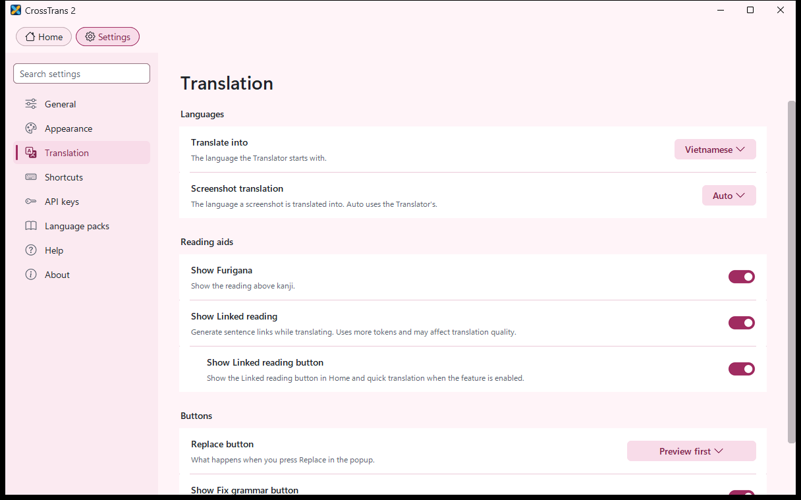
</p>

### Giao diện & Cỡ chữ (`Settings → Appearance`)
- Tùy chọn nhiều giao diện **Sáng, Tối, Pastel** hoặc **Follow Windows** (tự đổi theo chế độ sáng/tối của Windows).
- Chuyển ngôn ngữ giao diện giữa **English** và **Japanese (日本語)**.
- Tăng/giảm **Text size** (100% – 150%+) dễ đọc trên mọi màn hình độ phân giải cao.

<p align="center">
  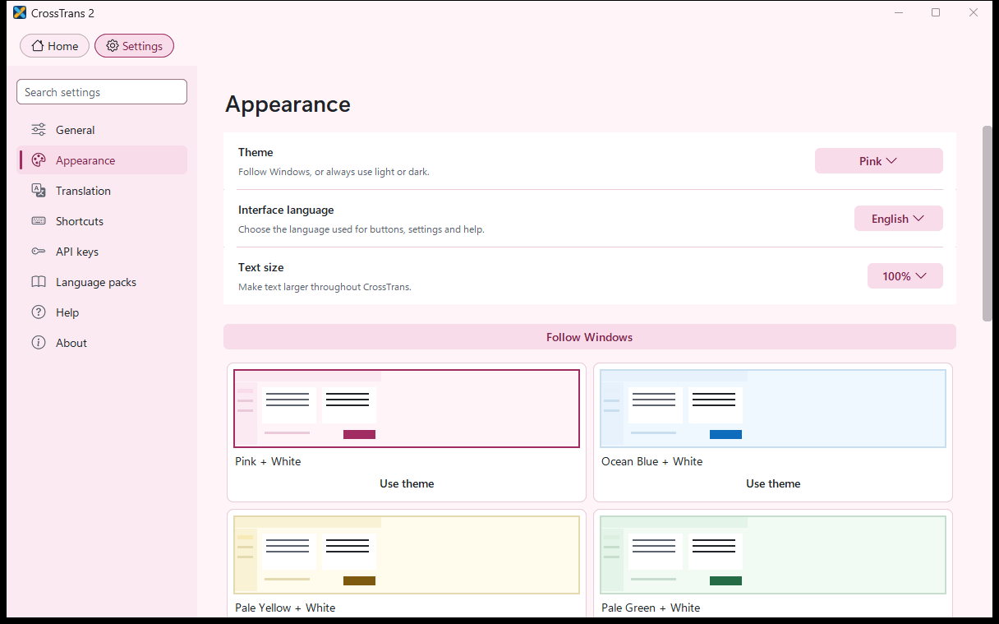
</p>

---

## 11. Tự động cập nhật, Quyền riêng tư & Chẩn đoán lỗi

Mở **Settings → About** để kiểm tra phiên bản, cập nhật phần mềm hoặc xuất báo cáo chẩn đoán lỗi.

<p align="center">
  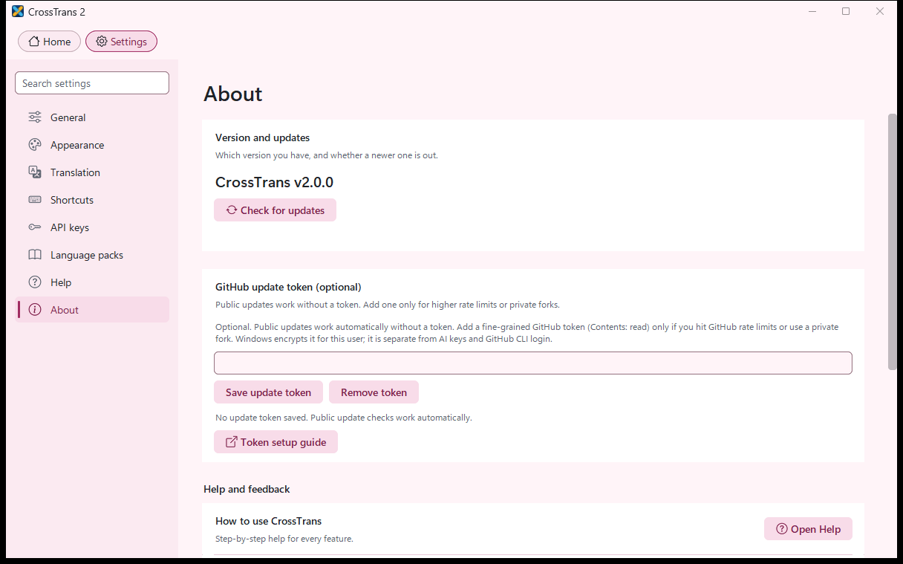
</p>

### Tự động cập nhật (Auto-Update)
- CrossTrans 2 tự động kiểm tra bản mới trên **GitHub Releases** mỗi khi khởi động và mỗi ngày một lần (bật/tắt tại **Settings → General → Check for updates automatically**), hoặc bấm **Check for updates** bất cứ lúc nào.
- **Cập nhật công khai hoạt động tự động mà KHÔNG cần nhập GitHub token.** Trước khi chạy bộ cài cập nhật, CrossTrans luôn xác minh mã băm **SHA-256** để đảm bảo file tải về an toàn tuyệt đối.
- **Ô GitHub update token (tùy chọn):** Người dùng thông thường **không cần điền ô này**. Chỉ cần dùng nếu mạng công ty bạn dùng chung IP khiến GitHub giới hạn 60 lượt kiểm tra/giờ, hoặc nếu bạn tự fork sang kho riêng tư.

### Quyền riêng tư & Báo lỗi nhanh (Diagnostics)
- Bấm **Open diagnostics** trong **Settings → About** để xem thông tin môi trường chạy, sao chép báo cáo hoặc xuất gói log gửi lên GitHub.
- **API key, GitHub token và toàn bộ lịch sử/văn bản dịch đều được tự động lọc bỏ** — không bao giờ bị lộ trong báo cáo hay log.
- Chỉ nên bật **Verbose debug logging** khi cần thu thập log chi tiết để báo lỗi, sau đó tắt lại.

---

## Troubleshooting

### Bấm phím tắt (`Win + Alt + V/E/J/C/S/A`) nhưng không thấy gì xảy ra
- Vào **Settings → Shortcuts**, kiểm tra công tắc **Enable shortcuts** đang bật và xem có dòng cảnh báo xung đột phím tắt ở dưới không.
- Một số ứng dụng khác (như Xbox Game Bar ở phím `Win + Alt + G`, phần mềm quay màn hình card đồ họa hoặc công cụ dịch khác) có thể đang chiếm phím tắt đó — hãy bấm **Change** để đổi sang tổ hợp phím khác.
- Nếu cửa sổ bạn đang mở chạy bằng quyền **Administrator** còn CrossTrans chạy quyền thường, cơ chế bảo mật Windows (UIPI) sẽ chặn ứng dụng thường đọc nội dung từ cửa sổ Admin.

### Dịch nhanh báo *"No text selected"* dù đã bôi đen chữ
- Đảm bảo vùng chữ thực sự đang được bôi đen trước khi bấm phím tắt.
- Một số phần mềm đặc thù (một vài trình đọc PDF, máy ảo Remote Desktop hoặc trường dữ liệu có khóa bảo vệ) chặn lệnh copy tự động. Hãy bấm **`Ctrl + C`** trước rồi bấm phím tắt dịch.
- Với **Microsoft Excel**: bạn có thể chọn trực tiếp ô Excel hoặc bôi đen chữ trong thanh công thức (Formula Bar), bấm phím tắt rồi thả tay tự nhiên.

### Lỗi API (401, 403, 429 hoặc thông báo chọn Provider)
- **Lỗi 401 / API key không hợp lệ:** Mở **Settings → API keys**, dán lại key cẩn thận (không dính dấu cách thừa) rồi bấm **Test**.
- **Lỗi 429 / Hết hạn mức tốc độ (Rate limit):** Các gói miễn phí có giới hạn số lượt/phút hoặc ngày. Chờ một lát hoặc thêm **Backup key** từ nhà cung cấp thứ 2 (ví dụ: Gemini + Groq) để CrossTrans tự chuyển đổi dự phòng.
- **Thông báo yêu cầu chọn Provider:** Một số key không có tiền tố đặc trưng (như key `sk-...` cũ, Mistral, SambaNova UUID) — hãy chọn đúng tên hãng tại mục **Provider** thay vì để `Auto`.
- **Chụp màn hình OCR hoặc dịch PDF bị lỗi:** Đảm bảo ít nhất 1 key của bạn có dấu tích **`Reads images ✓`** hoặc **`Reads files ✓`** tại **Settings → API keys** (một số model chỉ hỗ trợ văn bản thuần, không đọc được ảnh).

### Bấm Replace nhưng không dán đè vào ứng dụng
- Giữ nguyên đoạn chữ đang bôi đen khi bấm **Replace** → **Agree**.
- Các vùng chỉ đọc (như trang web, PDF) không thể ghi đè, và vài ứng dụng chặn lệnh dán tự động. Đừng lo — bản dịch vẫn luôn nằm sẵn trong clipboard, bạn chỉ cần bấm **`Ctrl + V`** để dán thủ công.

### Ghi âm PC Audio hoặc Micro không có tiếng
- Với **PC audio**, hãy chắc chắn âm thanh đang phát đúng thiết bị loa đã chọn trong **Settings → API keys → Audio devices**.
- Với **Microphone**, kiểm tra quyền truy cập micro của Windows tại *Windows Settings → Privacy & security → Microphone* đã cho phép ứng dụng desktop sử dụng chưa.
- Khi thu đồng thời **PC + Microphone**, nên đeo tai nghe để tránh tiếng loa dội ngược vào micro gây lẫn tạp âm.

### Nháy đúp CrossTrans 2 nhưng không thấy cửa sổ hiện lên
- CrossTrans 2 chỉ chạy 1 tiến trình duy nhất tại một thời điểm. Hãy kiểm tra **Khay hệ thống (System Tray)** gần đồng hồ ở góc dưới bên phải màn hình (bấm mũi tên `^` nếu bị ẩn) — rất có thể ứng dụng đang chạy sẵn ở đó! Nhấp chuột phải hoặc nháy đúp vào biểu tượng để mở cửa sổ.

### Vẫn cần hỗ trợ thêm?
- Mở **Settings → About → Open diagnostics**, bấm **Report on GitHub** và dán báo cáo (đã tự động ẩn toàn bộ key và lịch sử) vào trang [Báo lỗi trên GitHub](https://github.com/Masaru-urasaM/CrossTrans2/issues/new/choose).
